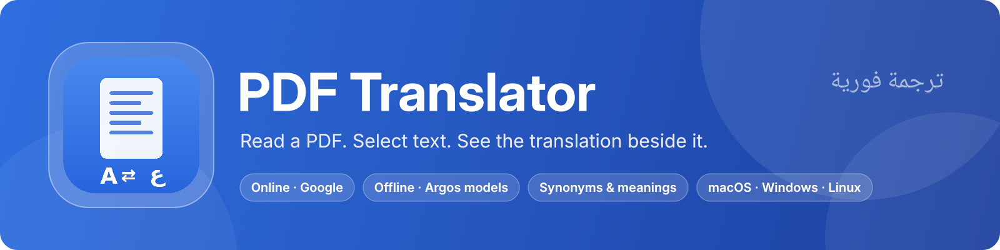
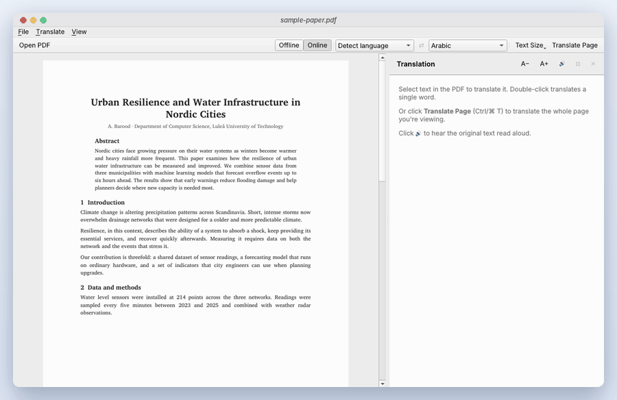
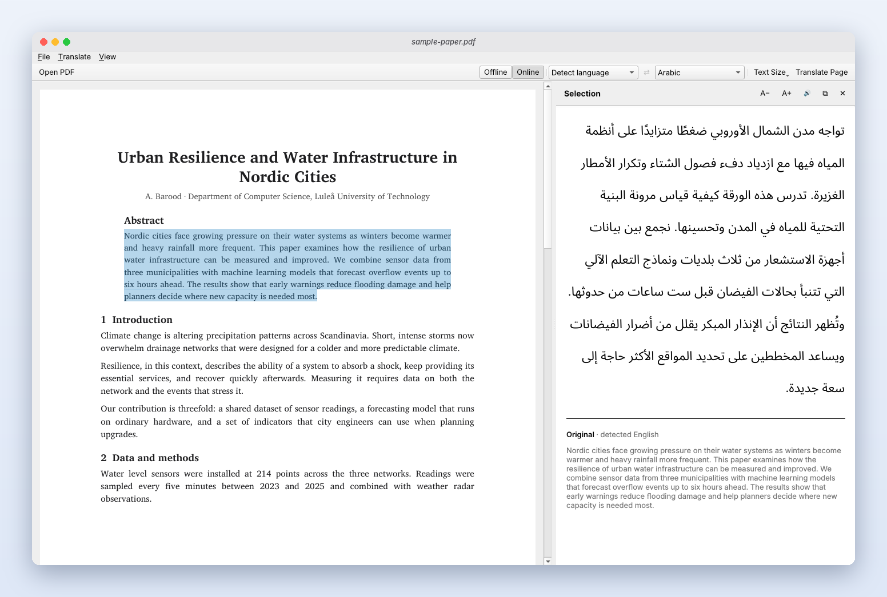
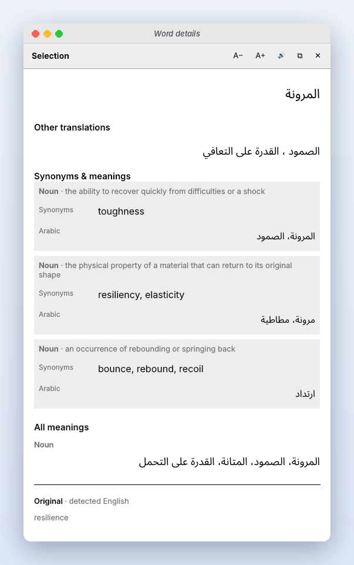
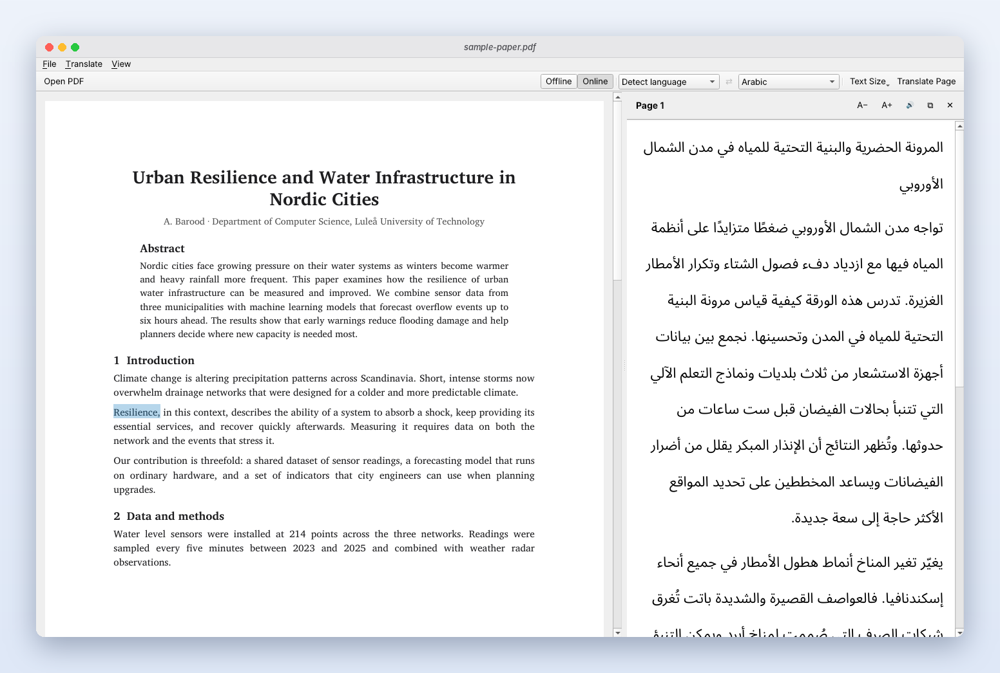
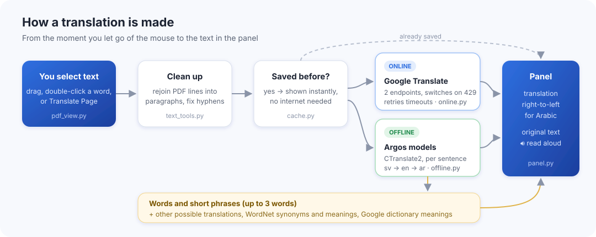

<p align="center">
  
</p>

<p align="center">
  
  
  
  
  
</p>

A desktop PDF reader with side-by-side translation, written in Python. The PDF is on the left and the
translation on the right: select text (or double-click a word) and it is translated as soon as you let go
of the mouse, or translate the whole page at once.

It works **online** with Google Translate, or **offline** with open-source
[Argos Translate](https://github.com/argosopentech/argos-translate) models running on your own computer.

<p align="center">
  
</p>

## Screenshots

<p align="center">
  
  <br><sub>Select a paragraph: the translation appears on the right, with the original underneath.</sub>
</p>

<table>
  <tr>
    <td width="38%" valign="top"></td>
    <td valign="top"></td>
  </tr>
  <tr>
    <td align="center"><sub>Double-click a word for other translations, synonyms and meanings.</sub></td>
    <td align="center"><sub><b>Translate Page</b> turns the page you're reading into clean paragraphs.</sub></td>
  </tr>
</table>

## How it works

<p align="center">
  
</p>

## Features

- **Select to translate**: drag over text, double-click a word, or Shift-click to extend a selection.
  Selections can cross pages.
- **Translate Page** (Ctrl/⌘ T) translates the page you're looking at. PDF line breaks and end-of-line
  hyphenation are cleaned up first, so paragraphs translate as paragraphs.
- **Offline | Online** switch (Ctrl/⌘ Shift L).
  - Online uses Google's two free web endpoints and switches automatically if one is rate-limited (HTTP 429),
    with retries for timeouts and server errors.
  - Offline uses CTranslate2 models. Language pairs without a direct model go through English
    (e.g. Swedish → English → Arabic).
- **Word details** for selections of up to three words: other possible translations, synonyms and meanings
  from WordNet with the matching words in the target language, and Google's dictionary meanings when online.
- **Read aloud** the original (Ctrl/⌘ R) or the translation (Ctrl/⌘ Shift R) with the system's voices.
- **Saved translations**: anything translated once comes back instantly, without asking Google again.
- Right-to-left layout for Arabic, Persian, Hebrew, Urdu and Kurdish (Sorani); 32 languages plus automatic
  detection. Default: Detect language → Arabic.
- Adjustable translation text size (Ctrl/⌘ +, −, 0), drag and drop, and a wide draggable divider.

## Install

Needs Python 3.9 or newer.

```bash
git clone https://github.com/amerbarood/pdf-translator-V3.0.git
cd pdf-translator-V3.0
python3 -m venv .venv
source .venv/bin/activate          # Windows: .venv\Scripts\activate
pip install -r requirements.txt
python -m pdftranslator            # or: python -m pdftranslator path/to/file.pdf
```

`pip install .` also installs a `pdftranslator` command.

### Offline translation (optional)

```bash
pip install -r requirements-offline.txt
python -m pdftranslator.offline_setup setup       # English ↔ Arabic, English ↔ Swedish and WordNet (~550 MB)
python -m pdftranslator.offline_setup install fr  # add another language (both directions with English)
python -m pdftranslator.offline_setup list        # languages that have packs
```

Language packs can also be installed from inside the app: **Translate › Offline Language Packs…**.
Without them the app works normally in Online mode.

## Where things are stored

Everything the app keeps lives in one folder, `~/PDFTranslator` (set `PDFTRANSLATOR_HOME` to use another one):

| Folder | Contents |
|---|---|
| `Data/translations.json` | Saved translations (up to 3,000, oldest dropped first) |
| `Offline/packs/<from>_<to>/` | Argos Translate models |
| `Offline/nltk_data/` | WordNet and the Open Multilingual Wordnet |

## Keyboard shortcuts

| Action | Shortcut (⌘ on macOS, Ctrl elsewhere) |
|---|---|
| Open PDF | ⌘ O |
| Translate page | ⌘ T |
| Swap languages | ⌘ ⇧ S |
| Offline / online | ⌘ ⇧ L |
| Read original / translation aloud | ⌘ R / ⌘ ⇧ R |
| Stop speaking | ⌘ . |
| Copy translation | ⌘ ⇧ C |
| Copy selected PDF text | ⌘ C |
| Text size bigger / smaller / default | ⌘ + / ⌘ − / ⌘ 0 |

## Project structure

```
pdftranslator/
  app.py            entry point
  main_window.py    window, toolbar, menus, and the app's state (what is being translated, settings)
  pdf_view.py       PDF viewer with word-level text selection (PyMuPDF)
  panel.py          translation panel (translation, word details, original)
  translator.py     saved translations → online or offline translation → word details
  online.py         Google endpoints, fallback and retries
  offline.py        Argos/CTranslate2 translation, language detection, WordNet lookups
  offline_setup.py  downloads language packs and WordNet
  text_tools.py     paragraph reflow, sentence splitting, request-sized chunks
  cache.py, speaker.py, languages.py, models.py, paths.py
tests/              unit tests and window smoke tests
```

## Tests

```bash
pip install pytest
python -m pytest
```

The window tests run headless (`QT_QPA_PLATFORM=offscreen`).

## Notes

- Online mode uses Google Translate's free web endpoints, which are unofficial and can be rate-limited.
  Offline mode is the fallback.
- Offline quality is below Google's, and word lists from WordNet don't cover every word.
- Scanned PDFs (images without a text layer) can't be translated; the app says so.
- Read-aloud uses Qt Text to Speech: built-in voices on macOS and Windows; on Linux it needs
  speech-dispatcher.
- Python version of my earlier native macOS app (SwiftUI + PDFKit), rebuilt to run on every platform.
